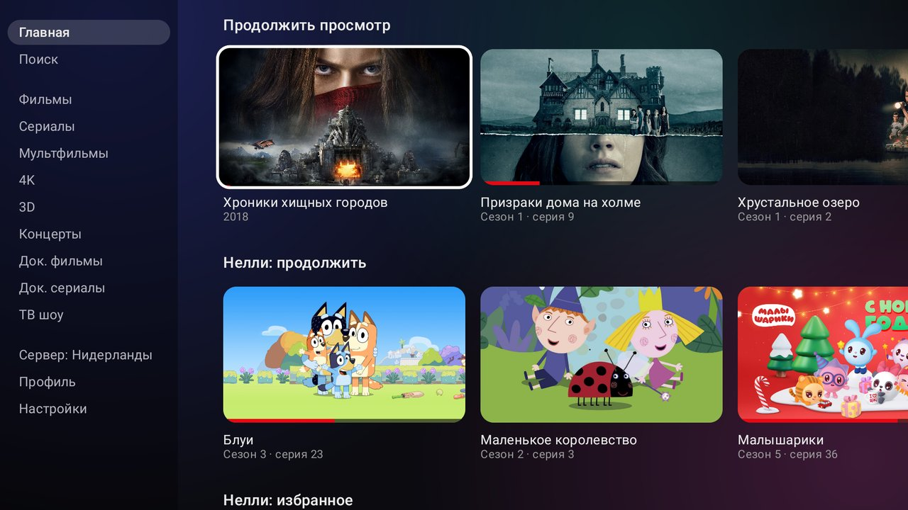
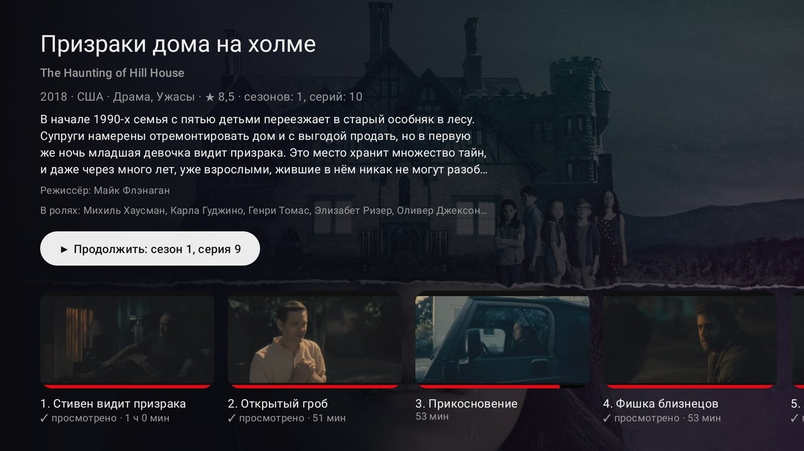
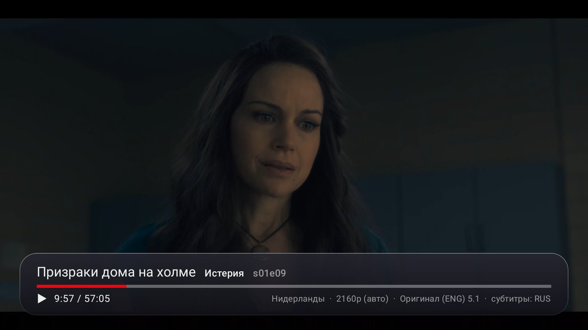
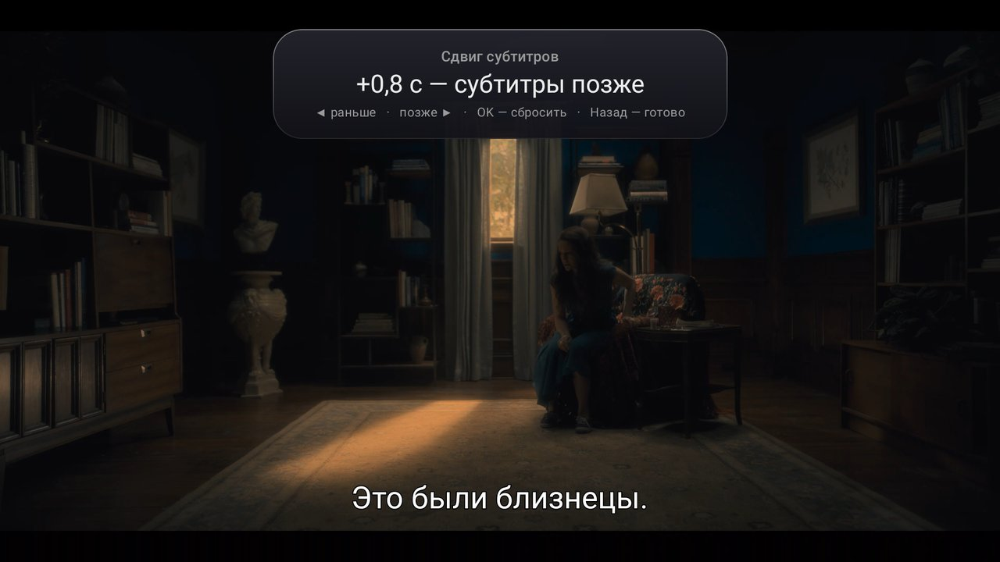

# moskwin-pub

Приложение для просмотра kino.pub на телевизоре с Android TV.

## [⬇ Скачать приложение (APK, 2,5 МБ)](https://github.com/UserNameMoskwin/moskwin-pub/raw/claude/sharp-edison-fpgtyq/apk/moskwin-pub.apk)

Нужны телевизор или приставка с Android TV 8 или новее и действующая подписка kino.pub.

## Установка

1. Скачайте файл по ссылке выше на компьютер или телефон.
2. Перенесите его на телевизор. Проще всего одним из двух способов:
   - **Флешка.** Запишите файл на флешку и вставьте её в телевизор.
   - **По Wi-Fi.** Поставьте приложение Send Files to TV из Google Play на телефон
     и на телевизор и отправьте файл с телефона.
3. Откройте файл на телевизоре через любой проводник. Если проводника нет, поставьте
   из Google Play, например, File Commander.
4. Телевизор спросит разрешение на установку из неизвестных источников. Разрешите его
   для проводника и нажмите «Установить».
5. Приложение появится в списке приложений под названием moskwin-pub.

Обновление ставится так же: новый файл устанавливается поверх старого, вход и
настройки сохраняются.

## Вход

1. Запустите приложение. На экране появятся адрес сайта и код.
2. Откройте этот адрес на телефоне или компьютере и войдите в свой аккаунт kino.pub.
3. Введите код с экрана телевизора.
4. Телевизор сам перейдёт на главный экран, нажимать ничего не нужно.

Пароль на телевизоре вводить не придётся. Вход делается один раз.

## Что умеет

**Главный экран и каталог**

- Ряд «Продолжить просмотр» с того места, где вы остановились.
- Новинки фильмов и сериалов с оценкой IMDb.
- Меню слева: фильмы, сериалы, мультфильмы, 4K, 3D, концерты, документальное, ТВ-шоу.
- Фильтры по жанру, стране и году, сортировка, поиск по названию.
- Выбор сервера прямо из меню.

**Карточка фильма и сериала**

- Описание, оценка, сезоны и серии с отметками о просмотре.
- Кнопка «Продолжить» запускает нужную серию с нужной минуты.

**Плеер**

- Выбор озвучки, субтитров, качества, скорости и сервера во время просмотра.
- Сдвиг звука и сдвиг субтитров, если они не совпадают с картинкой: шаг 0,1 секунды,
  до 10 секунд в любую сторону. Сдвиг запоминается для каждого фильма и серии.
- Выбранные озвучка и субтитры запоминаются.
- Автозапуск следующей серии.

| Кнопка пульта | Действие |
|---|---|
| OK | пауза и продолжение |
| Влево, вправо | перемотка на 15 секунд |
| Вниз | название, серия и время |
| Вверх | настройки плеера |
| Назад | закрыть панель или выйти |

**Режим ребёнка**

- Отдельные ряды на главном экране с мультфильмами ребёнка: что он смотрит сейчас
  и его избранное. Имя ребёнка задаётся в настройках.
- Кнопка «Для …» в карточке добавляет мультфильм в детское избранное.
- Мультфильмы включаются в дубляже и без субтитров.
- Режим выключается в настройках одним переключателем.

**Настройки**

- Качество видео, выбор плеера, тест скорости, отключение аниме в новинках,
  вид субтитров.

## Чего пока нет

- Автоматической подстройки частоты кадров телевизора под фильм.
- Телеканалов и подборок.

---

Для разработчиков: [сборка и устройство проекта](docs/development.md),
[требования и принятые решения](docs/spec.md).
