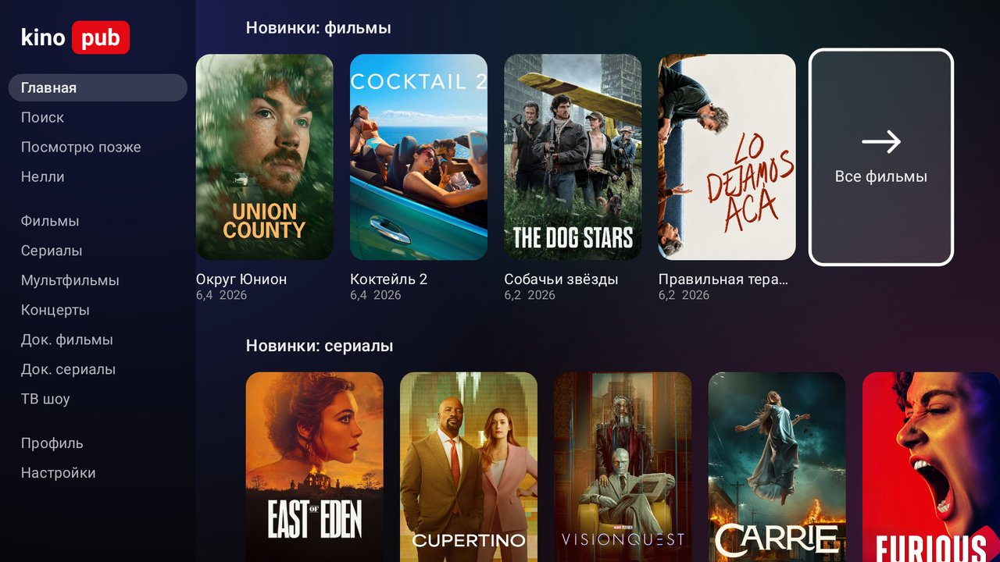
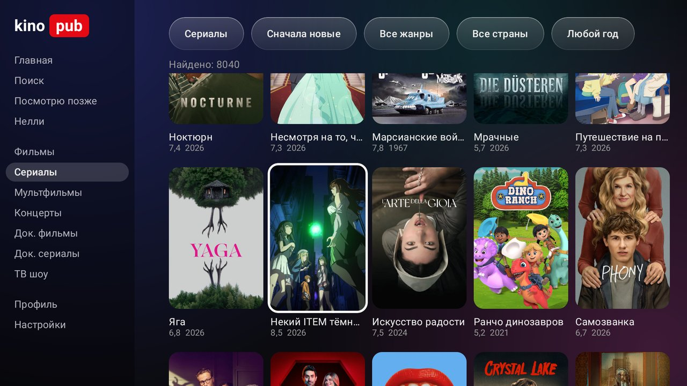
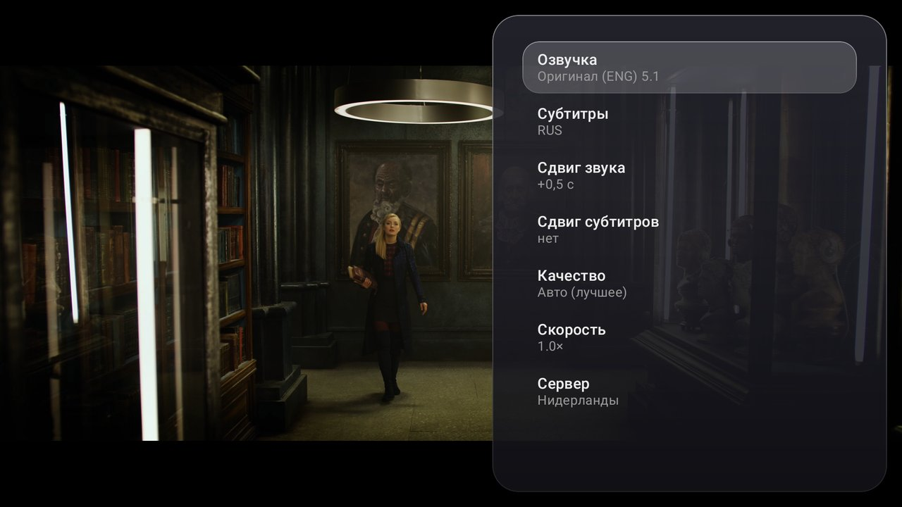
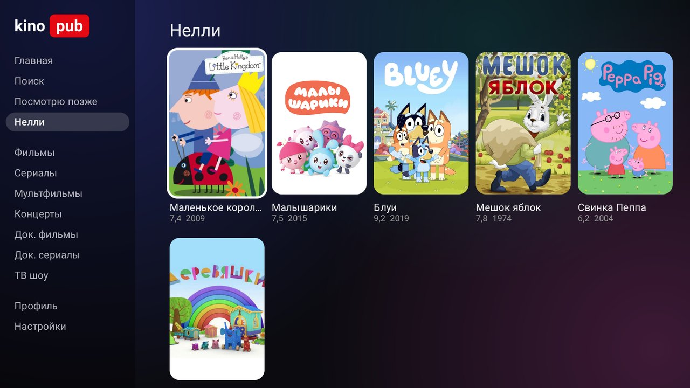
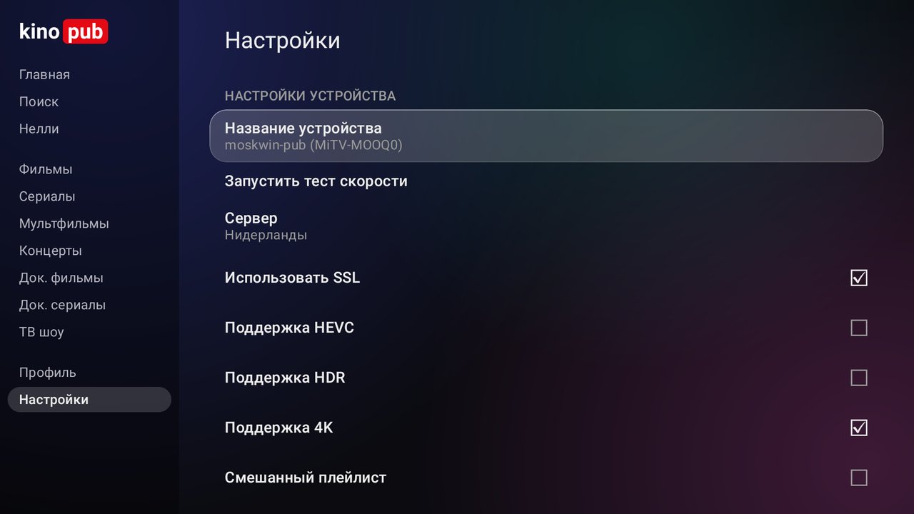

# KinoPub для Android TV

Приложение для просмотра [kino.pub](https://kino.watch) на телевизоре с Android TV или
Google TV. Работает с обычным аккаунтом и подпиской kino.pub — тем же сервисом, что
и сайт: сейчас он открывается по адресу [kino.watch](https://kino.watch).

Это неофициальное приложение: его делает не команда kino.pub. Фильмы, сериалы, история
просмотра и закладки берутся из вашего аккаунта, поэтому всё, что вы смотрите здесь,
видно и на сайте, и в других приложениях kino.pub.

## [⬇ Скачать приложение, версия 1.2 (APK, 2,5 МБ)](https://github.com/UserNameMoskwin/kino-pub-modern/raw/main/apk/kino-pub-1.2.apk)

Что нужно:

- телевизор или приставка с **Android TV 8 или новее** либо с **Google TV**;
- действующая подписка kino.pub.

## Подойдёт ли ваш телевизор

| Телевизор | Можно поставить |
|---|---|
| Xiaomi, Sony, Philips, TCL, Hisense и другие на Android TV или Google TV | да |
| Приставки на Android TV и Google TV: Xiaomi Mi Box и TV Stick, Chromecast с Google TV, Google TV Streamer и другие | да |
| Samsung (система Tizen) | нет |
| LG (система webOS) | нет |
| Apple TV, телевизоры с VIDAA, Roku, Titan OS | нет |

Если у вас Samsung или LG, приложение можно смотреть через приставку на Google TV или
Android TV: она подключается к любому телевизору по HDMI.

Как узнать, что на телевизоре Android TV: в настройках есть раздел «Об устройстве» с
пунктом «Версия Android» (или «Версия ОС Android TV»), а на главном экране — Google Play.

## Установка

1. **Скачайте файл** по ссылке выше на компьютер или телефон.
2. **Перенесите его на телевизор** — одним из двух способов:
   - **Флешка.** Запишите файл на флешку и вставьте её в телевизор.
   - **По Wi-Fi.** Поставьте приложение Send Files to TV из Google Play на телефон и
     на телевизор и отправьте файл с телефона.
3. **Откройте файл на телевизоре** через проводник. Если проводника нет, поставьте из
   Google Play, например, File Commander или X-plore.
4. **Разрешите установку.** Телевизор спросит разрешение устанавливать приложения
   из неизвестных источников — разрешите его для проводника. Если вопроса не было, а
   установка не идёт, включите разрешение сами, см. [ниже](#разрешение-на-установку).
5. **Нажмите «Установить».** Если появится предупреждение Google Play Защиты о
   неизвестном приложении, выберите «Всё равно установить»: оно показывается для любых
   приложений не из Google Play.
6. Приложение появится в списке приложений под названием **KinoPub**.

Больше ничего настраивать не нужно.

### Разрешение на установку

Android ставит приложения не из Google Play только с вашего разрешения. Его дают тому
приложению, которым вы открываете файл, — проводнику. Название пунктов отличается от
телевизора к телевизору, но путь обычно один из этих:

- **Google TV** (новые Xiaomi, Sony, TCL, Hisense, Chromecast с Google TV):
  Настройки → Система → Об устройстве → нажмите на «Сборку ОС Android TV» 7 раз, пока
  не появится «Вы стали разработчиком». Затем Настройки → Приложения → Безопасность и
  ограничения → Неизвестные источники → включите для проводника.
- **Android TV** (Xiaomi Mi TV и Mi Box, Sony, Philips, TCL):
  Настройки → Настройки устройства → Безопасность и ограничения → Неизвестные
  источники → включите для проводника.
- На некоторых моделях разрешение появляется только в момент установки: просто
  откройте файл, и телевизор сам предложит его включить.

Инструкции производителей:
[Xiaomi](https://www.mi.com/global/support/faq/details/KA-06364) ·
[Sony](https://www.sony.ie/electronics/support/articles/00226737) ·
[TCL](https://tcl.com/hk/en/support-tv/faq/2839) ·
[как открыть режим разработчика на Android TV](https://developer.android.com/studio/debug/dev-options).

После установки разрешение можно выключить. Для обновлений оно понадобится уже самому
KinoPub — об этом ниже.

## Вход

1. Запустите приложение. На экране появятся адрес и короткий код.
2. Откройте на телефоне или компьютере [kino.watch/device](https://kino.watch/device)
   и войдите в свой аккаунт kino.pub, если ещё не вошли.
3. Введите код с экрана телевизора.
4. Телевизор сам перейдёт на главный экран, нажимать ничего не нужно.

Пароль на телевизоре вводить не придётся, вход делается один раз. Телевизор появится
в списке устройств вашего аккаунта kino.pub под именем «KinoPub» с названием модели;
имя меняется в настройках приложения.

## Обновление

Скачивать приложение заново не нужно: обновления приходят прямо в него.

1. При запуске приложение проверяет, не вышла ли новая версия. Если вышла, в меню
   рядом с «Настройками» загорается красная точка.
2. В настройках первой строкой будет «Доступна версия …». Нажмите её — откроется
   список того, что изменилось.
3. Нажмите «Скачать и установить». Приложение скачает новую версию, и телевизор
   спросит, установить ли обновление. Подтвердите.

Вход, настройки, история и закладки сохраняются.

В первый раз телевизор попросит разрешить KinoPub устанавливать приложения — так же,
как при первой установке для проводника. Разрешите: без этого обновление не встанет.

Если обновлений нет, первая строка настроек так и говорит: «У вас актуальная версия».
Нажатие на неё проверяет ещё раз.

## Что умеет

**Главный экран и каталог**

- Ряд «Продолжить просмотр» с того места, где вы остановились.
- Новинки фильмов и сериалов с оценкой IMDb; стрелка в конце ряда открывает весь раздел.
- Меню слева: фильмы, сериалы, мультфильмы, концерты, документальное, ТВ-шоу.
- Фильтры по жанру, стране и году, сортировка, поиск по названию.
- Раздел «Посмотрю позже»: фильм или сериал добавляется туда одной кнопкой из карточки.
- Кнопка «Назад» из любого места возвращает в меню.

**Карточка фильма и сериала**

- Описание, оценка, сезоны и серии с отметками о просмотре.
- Кнопка «Продолжить» запускает нужную серию с нужной минуты.

**Плеер**

- Выбор озвучки, субтитров, качества, скорости и сервера во время просмотра.
- Кнопки предыдущей и следующей серии рядом с паузой.
- Настройка картинки: по ширине, по высоте, на весь экран — если у фильма чёрные поля.
- Сдвиг звука и сдвиг субтитров, если они не совпадают с картинкой: шаг 0,1 секунды,
  до 10 секунд в любую сторону. Сдвиг запоминается для каждого фильма и серии.
- Выбранные озвучка и субтитры запоминаются.
- Автозапуск следующей серии.

| Кнопка пульта | Действие |
|---|---|
| OK | пауза и продолжение |
| Влево, вправо | перемотка на 15 секунд |
| Вниз | название, серия, время и кнопки серий |
| Вверх | настройки плеера |
| Назад | закрыть панель или выйти |

**Режим ребёнка**

- Отдельный ряд на главном экране: мультфильмы, которые ребёнок смотрит сейчас.
- Отдельный пункт меню с именем ребёнка — его избранное. Имя задаётся в настройках.
- Кнопка со значком ребёнка в карточке добавляет мультфильм в это избранное.
- Мультфильмы включаются в дубляже и без субтитров.
- Режим выключается в настройках одним переключателем.

**Настройки и профиль**

- Напоминание о подписке: за неделю до её конца у «Профиля» загорается красная точка,
  а в профиле — подсказка, где её продлить.
- Качество видео, выбор сервера и плеера, тест скорости, отключение аниме в новинках,
  вид субтитров. Под каждым пунктом написано, что он делает.

## Если что-то не так

**Файл не открывается или «Приложение не установлено».** Проверьте, что разрешение на
установку дано именно тому проводнику, которым вы открываете файл. Если на телевизоре
уже стоит самая первая сборка (версия 0.1), удалите её и поставьте заново:
старая и новая сборки подписаны разными ключами, поверх друг друга они не встают.

**Видео тормозит или долго запускается.** В настройках запустите тест скорости.
Если скорость низкая, выберите там же другой сервер. На слабых приставках помогает
пункт «Небольшой буфер».

**Звук или субтитры отстают от картинки.** Во время просмотра нажмите «вверх» и
выберите «Сдвиг звука» или «Сдвиг субтитров».

**Пропали чёрные поля или картинка обрезана.** «Вверх» → «Картинка» → «Целиком,
с полями».

**Нужно выйти из аккаунта.** Профиль → «Выйти из аккаунта на этом телевизоре».

**Кончилась подписка.** Продлить её можно на [kino.watch](https://kino.watch); в
приложении оплаты нет.

## Чего пока нет

- Автоматической подстройки частоты кадров телевизора под фильм.
- Телеканалов и подборок.

---

Для разработчиков: [сборка и устройство проекта](docs/development.md).
